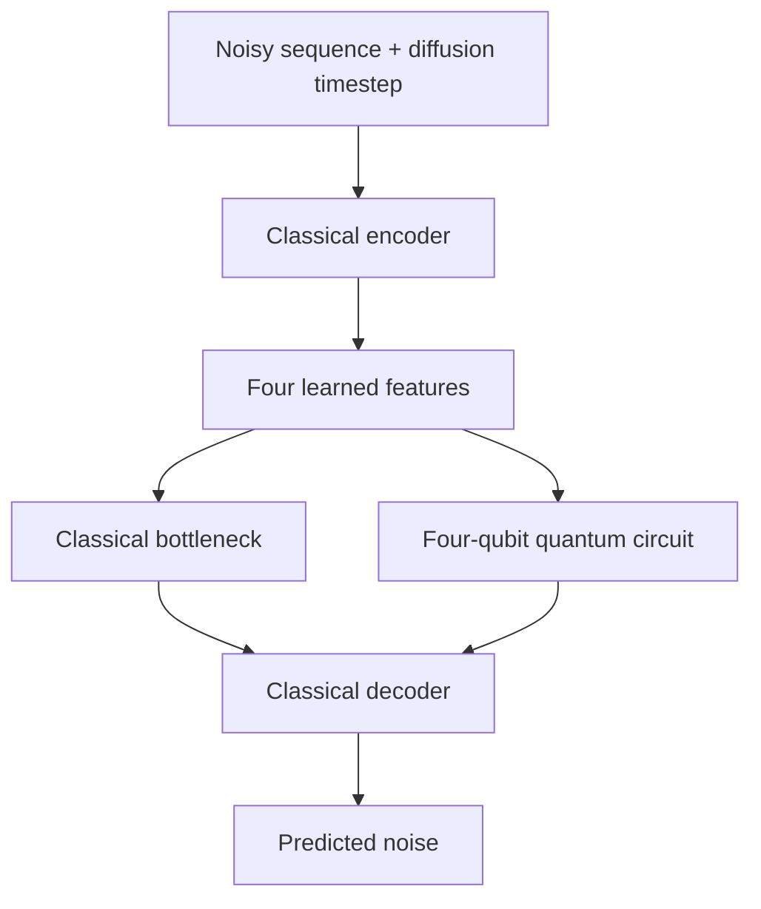

# Quantum Generative AI: A Survey of Hybrid Architectures and Emerging Applications

[](https://www.python.org/)
[](https://pytorch.org/)
[](https://www.ibm.com/quantum/qiskit)
[](https://qiskit-community.github.io/qiskit-machine-learning/)
[](https://numpy.org/)
[](https://scipy.org/)
[](https://matplotlib.org/)

A research experiment exploring how a small quantum circuit affects a generative AI model's ability to create time-series data.

This repository is the practical extension of a survey covering 25 selected research papers on quantum generative AI. It compares a conventional neural network with a hybrid quantum-classical network under the same data and training conditions.

## What does the project do?

A time series is a sequence of observations ordered in time. Here, the observations are short synthetic wave signals with varying amplitude, frequency, phase, harmonic components and noise. Each sequence has 32 points.

We use a **diffusion model**, a generative model that learns to remove deliberately added noise. After training, it starts from random Gaussian noise and repeatedly denoises it to produce a new sequence. The goal is for generated sequences to resemble the real wave signals in both their values and their temporal structure.

The experiment follows four steps:

1. **Create the data:** generate 1,400 sequences, divided into 1,000 training, 200 validation and 200 held-out reference sequences.
2. **Build a classical baseline:** train a small PyTorch network to predict diffusion noise using the noisy sequence and its diffusion timestep.
3. **Introduce a quantum component:** replace the network's four-dimensional bottleneck with a four-qubit circuit. The encoder, decoder and diffusion process stay the same.
4. **Compare the models:** evaluate generation quality, temporal patterns, runtime and behavior with less training data.

## Where does quantum computing fit?

The classical encoder reduces the noisy sequence and timestep information to four learned features. In the hybrid model, those features become rotation angles in a quantum circuit. Two trainable circuit layers transform the four-qubit state, and four expectation values return to the classical decoder.



The branches represent alternative bottlenecks: each model uses one. PyTorch trains the classical and quantum parameters together through the same loss function.

| Model | Bottleneck | Trainable parameters |
|---|---|---:|
| Classical baseline | Small classical layer | 1,816 |
| Hybrid quantum-classical | Four qubits and 16 trainable rotation parameters | 1,812 |
| Classical control | Classical layer adjusted to match the hybrid's parameter count | 1,812 |

The control helps investigate the effect of parameter count; equal counts do not guarantee equal model capacity. Quantum circuits currently run on an **ideal local simulator**, so no quantum hardware or IBM account is required.

## What do we aim to learn?

- **Generation quality:** how closely generated values match the held-out data, using Wasserstein distance and summary statistics.
- **Temporal consistency:** how well generated sequences preserve correlations across time, using autocorrelation functions.
- **Limited-data behavior:** what changes when training uses 1,000, 500, 250 or 100 sequences.
- **Computational cost:** how much training and generation time each model requires, including quantum-simulation workloads.

The aim is to measure the trade-offs under controlled conditions. Repeated experiments across three random seeds are planned to assess variability.

## Technologies and their roles

| Technology | Role |
|---|---|
| Python | Dataset generation, experiment orchestration and testing with unittest |
| PyTorch | Neural networks, automatic differentiation, optimization and diffusion training |
| Qiskit | Four-qubit circuits and ideal statevector simulation |
| Qiskit Machine Learning | EstimatorQNN and TorchConnector for trainable quantum-classical integration |
| NumPy | Signal generation, arrays, normalization and reproducible sampling |
| SciPy | Planned Wasserstein-distance evaluation |
| Matplotlib | Signal, loss, autocorrelation and circuit figures |

## Current status

The dataset pipeline, all three model architectures, shared training pipeline and reverse sampler are implemented. Quantum gradients and end-to-end hybrid training have been verified. The latest recorded test suite passed **58 tests**.

Classical and hybrid models have each completed a **five-update pilot**, generating 200 sequences per model. Full training, held-out quality metrics and repeated data-scarcity comparisons are pending.

**The pilots establish that the implementation works. Their generated samples remain noise-like; realistic generation and quantum advantage have not been demonstrated.**

## Getting started

Use Python 3.12 and run from the project directory:

```bash
python3.12 -m venv .venv
source .venv/bin/activate
python -m pip install -r requirements-lock.txt
```

Generate the dataset once and run the tests:

```bash
python data/generate_data.py
python -m unittest discover -s tests -v
```

Run a five-update pilot for either model:

```bash
python training/train.py --model classical --smoke --run-id classical_demo
python training/train.py --model hybrid --smoke --run-id hybrid_demo
```

Data are saved in `data/datasets/` and results in `results/`. Existing datasets and run IDs are protected against overwriting; use a fresh run ID for another pilot. Full experiments require an agreed training budget.

## Further reading

- [Experimental methodology](EXPERIMENTAL_METHODOLOGY.md): equations, architecture and fair-comparison protocol.
- [Implementation guide](IMPLEMENTATION_EXPLANATION.md): source files and their responsibilities.
- [Results](RESULTS.md): computed measurements and evaluations still pending.
