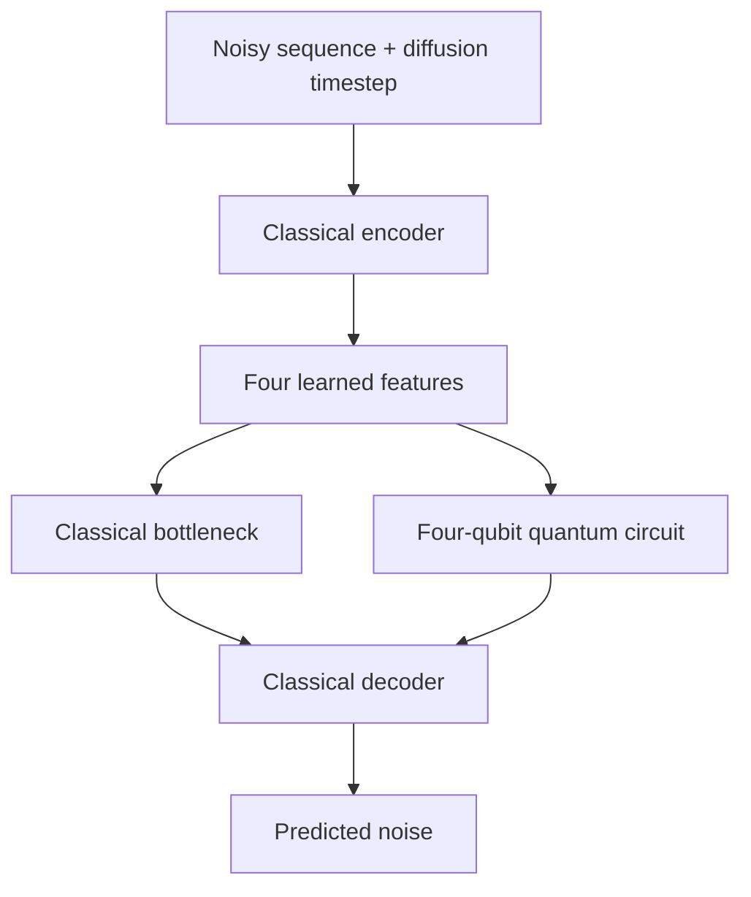

# Quantum Generative AI: A Survey of Hybrid Architectures and Emerging Applications

[](https://www.python.org/)
[](https://pytorch.org/)
[](https://www.ibm.com/quantum/qiskit)
[](https://qiskit-community.github.io/qiskit-machine-learning/)
[](https://numpy.org/)
[](https://scipy.org/)
[](https://matplotlib.org/)

A research experiment exploring how a small quantum circuit affects a generative AI model's ability to create time-series data.

This repository is the practical extension of a survey covering 25 selected research papers on quantum generative AI. It compares three configurations under the same data and training conditions: classical diffusion, hybrid quantum diffusion with noise MSE, and the same hybrid with autocorrelation-guided optimization.

## What does the project do?

A time series is a sequence of observations ordered in time. Here, the observations are short synthetic wave signals with varying amplitude, frequency, phase, harmonic components and noise. Each sequence has 32 points.

We use a **diffusion model**, a generative model that learns to remove deliberately added noise. After training, it starts from random Gaussian noise and repeatedly denoises it to produce a new sequence. The goal is for generated sequences to resemble the real wave signals in both their values and their temporal structure.

The experiment follows five steps:

1. **Create the data:** generate 1,400 sequences, divided into 1,000 training, 200 validation and 200 held-out reference sequences.
2. **Build a classical baseline:** train a small PyTorch network to predict diffusion noise using the noisy sequence and its diffusion timestep.
3. **Introduce a quantum component:** replace the network's four-dimensional bottleneck with a four-qubit circuit. The encoder, decoder and diffusion process stay the same.
4. **Guide temporal structure:** train a second, identically initialized hybrid using noise MSE plus a differentiable autocorrelation loss.
5. **Compare the three configurations:** evaluate generation quality, temporal patterns, runtime and behavior with less training data.

## Where does quantum computing fit?

The classical encoder reduces the noisy sequence and timestep information to four learned features. In the hybrid model, those features become rotation angles in a quantum circuit. Two trainable circuit layers transform the four-qubit state, and four expectation values return to the classical decoder.



The branches represent alternative bottlenecks: each model uses one. PyTorch trains the classical and quantum parameters together through the selected training objective.

| Model | Bottleneck | Trainable parameters |
|---|---|---:|
| Classical baseline | Small classical layer | 1,816 |
| Hybrid quantum-classical | Four qubits and 16 trainable rotation parameters | 1,812 |
| Hybrid + ACF | Same four-qubit circuit; additional autocorrelation training loss | 1,812 |
| Optional classical control | Classical layer adjusted to match the hybrid's parameter count | 1,812 |

The control helps investigate the effect of parameter count; equal counts do not guarantee equal model capacity. Quantum circuits currently run on an **ideal local simulator**, so no quantum hardware or IBM account is required.

## What do we aim to learn?

- **Generation quality:** how closely generated values match the held-out data, using Wasserstein distance and summary statistics.
- **Temporal consistency:** how well generated sequences preserve correlations across time, using autocorrelation functions.
- **Limited-data behavior:** what changes when training uses 1,000, 500, 250 or 100 sequences.
- **Computational cost:** how much training and generation time each model requires, including quantum-simulation workloads.

The aim is to measure the trade-offs under controlled conditions. Repeated experiments across three random seeds are planned to assess variability.

## Technologies and their roles

| Technology | Role |
|---|---|
| Python | Dataset generation, experiment orchestration and testing with unittest |
| PyTorch | Neural networks, automatic differentiation, optimization and diffusion training |
| Qiskit | Four-qubit circuits and ideal statevector simulation |
| Qiskit Machine Learning | EstimatorQNN and TorchConnector for trainable quantum-classical integration |
| NumPy | Signal generation, arrays, normalization and reproducible sampling |
| SciPy | Held-out Wasserstein-distance evaluation |
| Matplotlib | Signal, loss, autocorrelation and circuit figures |

## Current status

All three configurations are implemented. Phase 7 completed **36 budgeted final experiments** across three seeds and four training-set sizes, after validation-only budget/lambda selection. All final checkpoints reproduced their samples and metrics exactly; the latest suite passed **79 tests**. The study selected 1000 updates and lambda 1.0.

Phase 7 uses a shared revised 100-step schedule and an exact batched statevector backend checked against Qiskit. Its parameter counts are 3096 classical and 3092 hybrid because of the larger timestep embedding. The introductory architecture table and pilot commands below describe the historical default 20-step configuration.

**Generated signals remain noise-like with excessive amplitude; realistic generation, convergence and quantum advantage have not been demonstrated.** Seven phases are complete; Phase 8 analysis/reporting remains. See [Phase 7 results](PHASE7_RESULTS.md), [protocol](PHASE7_PROTOCOL.md), and [roadmap](PROJECT_PHASES.md).

## Getting started

Use Python 3.12 and run from the project directory:

```bash
python3.12 -m venv .venv
source .venv/bin/activate
python -m pip install -r requirements-lock.txt
```

Generate the dataset once and run the tests:

```bash
python data/generate_data.py
python -m unittest discover -s tests -v
```

Run all three configurations with five updates each and 200 generated sequences per configuration:

```bash
python experiments/compare.py --smoke --lambda-acf 1.0 --run-id my_three_config_pilot
```

Or run the guided hybrid alone:

```bash
python training/train.py --model hybrid_acf --smoke --lambda-acf 1.0 --run-id my_guided_pilot
```

`lambda_acf=1.0` is a provisional pilot setting, not a tuned scientific result. The objective is `noise_MSE + lambda_acf * ACF_MSE`, comparing lags 1–10 of the reconstructed clean sequence with its training target. Setting the weight to zero reproduces ordinary hybrid training. All modes select checkpoints by fixed-corruption validation **noise MSE**; test data never select checkpoints.

Data are saved in `data/datasets/` and results in `results/`. The comparison runner checks pairing and saves JSON plus a CSV in `results/tables/`. Each run records separate loss components, physical-unit held-out Wasserstein/ACF/moment metrics, timing and checkpoint provenance. Existing run IDs are protected against overwriting; use a fresh ID. Full experiments use an explicit `--max-steps` or `--epochs` budget instead of `--smoke`; use the same budget across all three configurations and tune settings on validation data only.

To execute or verify/reuse the frozen Phase 7 study (completed cases are checked and reused):

```bash
python experiments/phase7.py
```

Trained checkpoints stay local and are excluded from Git. On a fresh clone, generate the dataset first and reproduce the study into a fresh directory with `python experiments/phase7.py --results-dir results/phase7_reproduction`; the published result records refer to the original local checkpoints.

Phase 7 results are in `results/phase7/`, including the 36-run CSV, frozen selections, progress/completion records and source snapshot. Its lambda 1.0 was selected by the limited validation sweep; the smoke command's default remains a pilot setting.

## Further reading

- [Experimental methodology](EXPERIMENTAL_METHODOLOGY.md): equations, architecture and fair-comparison protocol.
- [Implementation guide](IMPLEMENTATION_EXPLANATION.md): source files and their responsibilities.
- [Results](RESULTS.md): computed measurements and evaluations still pending.

<!-- python training/train.py --model classical --smoke --run-id classical_demo                          -->
<!-- python training/train.py --model hybrid --smoke --run-id hybrid_demo                   -->
